# rtl-journal

Daily RTL practice from **HDLBits** and **Logicode**, logged automatically.

[](PROBLEMS.md)

Full list: [PROBLEMS.md](PROBLEMS.md)

## Daily loop

```bash
python add.py hdlbits "Vector reversal" --cat Vectors   # creates hdlbits/vector_reversal.v and logs it
# paste your solution into that file
python add.py --push                                    # pulls, commits, pushes; the card updates itself
```

- Logicode: `python add.py logicode "flippy_bits" --cat Sequences --ext sv`
- Backfill an older solve: add `--date 2026-11-01`
- Bar goals live in `GOALS` at the top of `stats.py`.
- Python 3.9+, standard library only (on Windows, `pip install tzdata` for exact IST handling).
